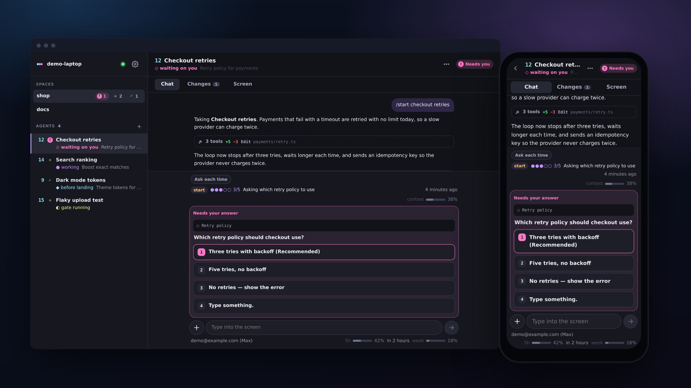
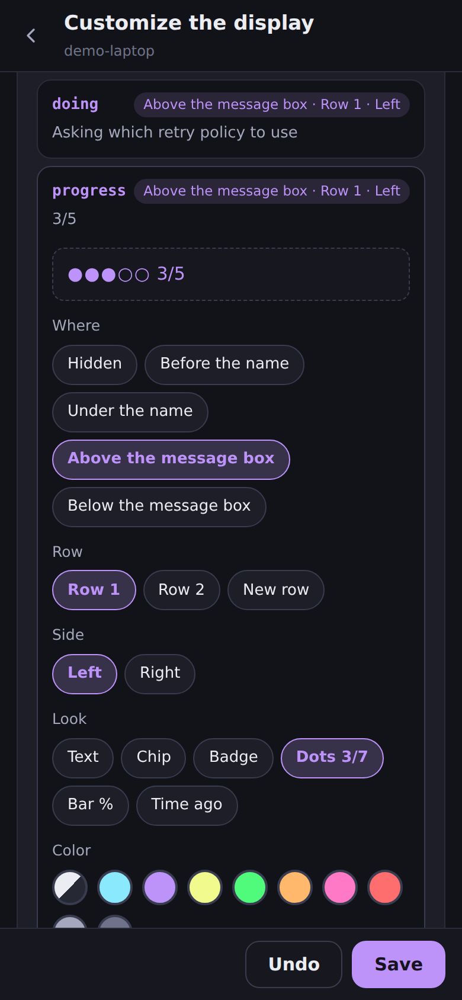
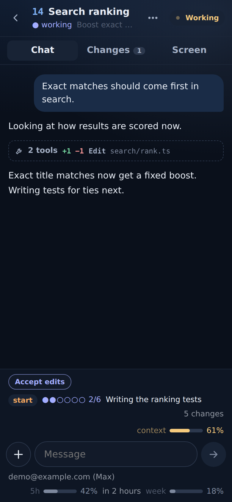
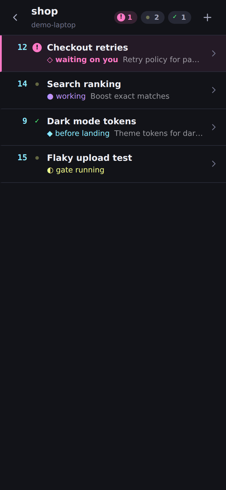
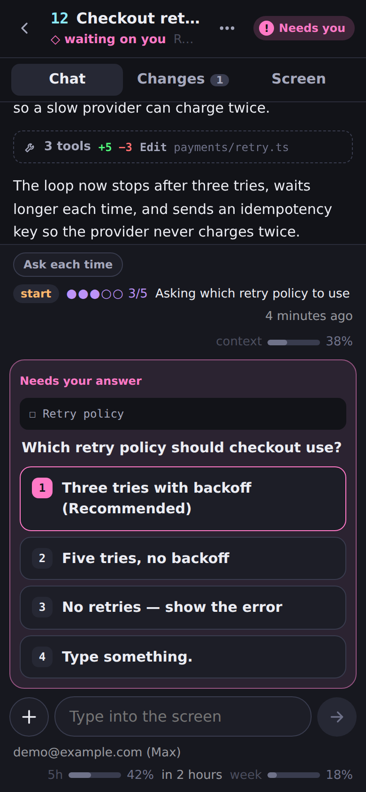
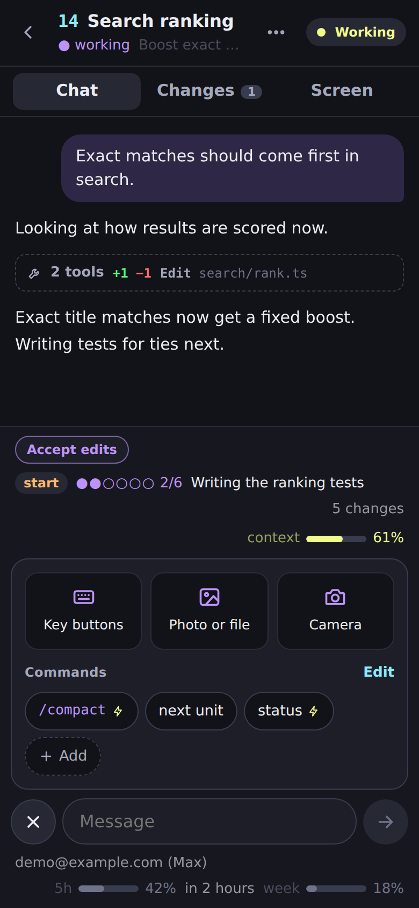
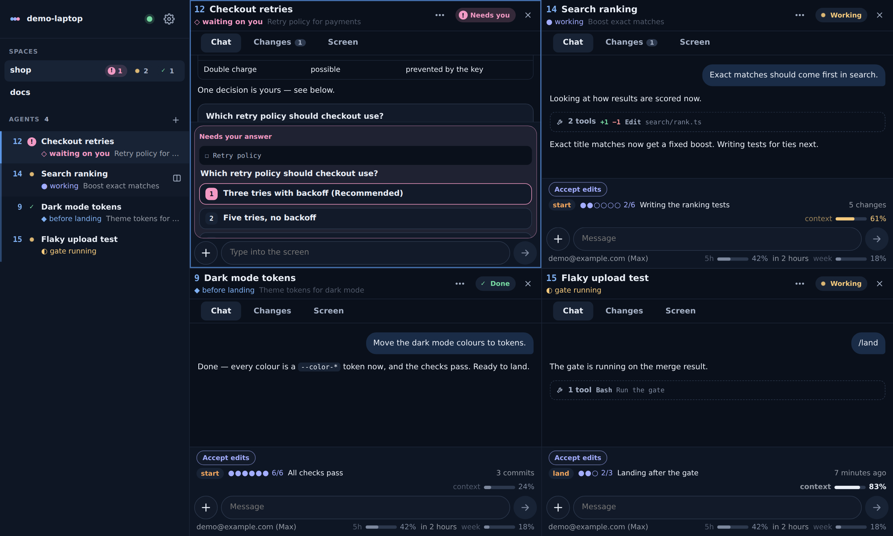
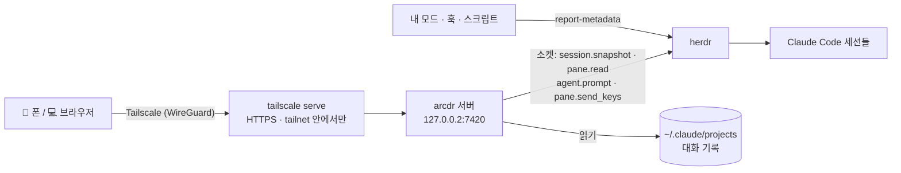

<div align="center">


# arcdr

**내 herdr 를 폰으로, 모드까지 그대로.**<br/>
herdr 에서 돌아가는 Claude Code 세션을 herdr 에서 보던 모습 그대로, 모드가 보내는 정보까지 함께 보여 줘요.
폰이나 다른 컴퓨터에서 질문에 답하고 일을 이어 가세요. 연결은 내 Tailscale 네트워크 안에서만 해요.

[](https://herdr.dev)
[](docs/mods.ko.md)
[](https://tailscale.com)
[](#폰에서)
[](https://bun.sh)
[](LICENSE)

[English](README.md) · **한국어**



</div>

---

## 말 한마디로 시작하기

herdr 가 도는 컴퓨터에서 아무 데서나 Claude Code 를 열고 이렇게 말하면 돼요.

> **https://github.com/arcnessai/arcdr 셋팅해줘**

이미 받아 둔 폴더가 있으면 그 폴더에서 「셋팅해줘」라고만 해도 돼요.

[`arcdr-setup`](.claude/skills/arcdr-setup/SKILL.md) 스킬이 저장소를 받고, 빠진 걸 설치하고, 서비스를 띄워요. 직접
열어야 하는 링크 두 개(Tailscale 로그인, HTTPS 켜기)는 따로 건네주고, 내가 정해야 하는 일은 먼저 물어봐요. 마지막에는
기본 모드도 설치할지 물어봐요. 설치하면 처음부터 대화 말고도 세션이 지금 뭘 하는지까지 폰에서 볼 수 있어요.

<a id="폰에서"></a>
**폰에서는:** 같은 계정으로 Tailscale 앱을 켜고 → Chrome 으로 `https://<기기>.<tailnet>.ts.net` 을 열고 →
**앱 설치** 를 누르세요. 다른 컴퓨터는 Tailscale 을 켜고 같은 주소를 열면 돼요.

## herdr 와 모드를 중심에 두고 만들었어요

Claude Code 를 원격으로 보는 도구는 대부분 대화 하나를 보여 줘요. arcdr 은 **내 작업 공간 전체**를 보여 줘요.
herdr 가 정리해 둔 그대로, 모드가 붙여 둔 정보까지요.

<table>
<tr>
<td width="50%" valign="top">

### herdr 그대로

- **목록이 곧 herdr 사이드바예요.** herdr 설정의 `rows_by_agent` 를 그대로 읽어서 번호도, 단계 색도, 순서도
  같아요. 따로 설정할 게 없어요.
- **스페이스와 탭도 herdr 그대로예요.** 폰에서 새 herdr 탭에 세션을 열고, 지난 대화를 이어 가고, 닫을 수 있어요.
- **상태는 herdr 가 알아낸 그대로예요.** 나를 기다리는 세션은 분홍색으로 바뀌고 폰이 울려요.
- **PC 에서는 여러 개를 한 번에.** herdr 에서 칸을 나누듯, 대화를 네 개까지 나란히 또는 2×2 로 볼 수 있어요.
- **Claude 계정이 여럿이어도 괜찮아요.** 칸마다 쓰던 계정 그대로 돌고, arcdr 은 내 Tailscale 계정만 확인해요.

</td>
<td width="50%" valign="top">

### 모드도 폰에서

| 터미널에서 모드가 그리던 것 | arcdr 에서 보이는 자리 |
|---|---|
| herdr 사이드바 줄의 토큰 | 에이전트 이름 앞이나 아래 |
| 입력칸 위 띠 | 메시지 입력칸 위 |
| 입력칸 아랫줄 | 메시지 입력칸 아래 |
| 안내 메시지 | 폰 알림 |
| 모드가 등록한 커맨드 | `/` 추천 목록 |

같은 값을, 내가 정해 둔 자리에, 같은 모양으로 보여 줘요.

</td>
</tr>
</table>

### 폰에 띄우는 네 가지 방법

| | |
|---|---|
| 🧩 **기본 모드** | `scripts/setup.sh mod` 로 [`arcdr-report`](mods/arcdr-report/README.md) 를 설치해요. 그다음부터는 세션마다 지금 쓰는 도구(`Edit rank.ts`), 일한 지 얼마나 됐는지, 할 일 목록(`●●●○○ 3/5`), 쓴 컨텍스트, 브랜치, 비용, 사용 한도가 보여요. 코드는 한 줄도 안 써도 돼요. |
| 💬 **말로 부탁하기** | 이 저장소에서 Claude Code 에게 「폰에 git 브랜치 보여 줘」, 「테스트 깨지면 폰으로 알려 줘」라고 말해요. [`arcdr-mod`](.claude/skills/arcdr-mod/SKILL.md) 스킬이 값을 보낼 훅이나 모드를 찾거나 만들고, 화면에 자리를 잡고, 제대로 보이는지까지 확인해요. |
| 🎨 **눌러서 꾸미기** | **설정 → 표시 → 표시 꾸미기** 에 모드가 보내는 값이 전부 나와요. 자리와 모양(칩, 점, 막대, 「4분 전」)을 고르면 미리 보기에 바로 반영돼요. |
| 🔔 **폰 울리기** | 모드든 훅이든 스크립트든 `herdr pane report-metadata "$HERDR_PANE_ID" --token notify="배포 끝"` 한 줄이면 폰 알림으로 와요. |

<table>
<tr>
<td width="50%"></td>
<td width="50%"></td>
</tr>
<tr>
<td><b>폰에서 바로 꾸미기</b><br/>모드가 보내는 값마다 자리와 모양을 고르면 바로 미리 보여 줘요.</td>
<td><b>터미널 밖으로 나온 띠</b><br/>모드가 Claude Code 입력칸 위에 그리던 띠가 메시지 입력칸 위에 그대로 나와요.</td>
</tr>
</table>

형식 전체와 자리, 실제 예시는 **[docs/mods.ko.md](docs/mods.ko.md)** 에 있어요.

## 그 밖에 할 수 있는 것

<table>
<tr>
<td width="33%"></td>
<td width="33%"></td>
<td width="33%"></td>
</tr>
<tr>
<td><b>모든 세션을 한눈에</b><br/>스페이스, 에이전트, 상태, 모드가 보낸 단계까지.</td>
<td><b>눌러서 답하기</b><br/>권한 확인, 질문, 계획 승인, 폴더 신뢰 확인이 버튼으로 나와요. 키를 보내기 직전에 화면을 한 번 더 읽어서, 그사이 메뉴가 바뀌었으면 보내지 않아요.</td>
<td><b>나머지는 ＋ 하나로</b><br/>키 버튼, 갤러리 사진, 카메라, 파일, 자주 쓰는 스킬과 커맨드까지 한 번에.</td>
</tr>
</table>

<details>
<summary><b>기능 전체 보기</b></summary>

| | |
|---|---|
| **대화** | 채팅처럼 보여 줘요. 마크다운, 표, 코드를 그리고, 도구 호출은 한 줄로 접고, 링크는 새 창에서 열려요 |
| **보내기** | 보내는 중 → 입력함 → 대기 중(에이전트가 일하는 동안) → 받음 순서로 보여 줘요. 대기 중인 메시지를 바로 보낼 수 있고, 쓰다 만 글은 세션마다 남겨 둬요. 한글 입력도 깨지지 않아요 |
| **자동완성** | `/` 를 치면 기본 커맨드, 스킬, 모드 커맨드가, `@` 를 치면 파일이 나와요 |
| **커맨드** | 자주 쓰는 스킬·커맨드를 등록해 두면 폰과 PC 에서 같은 목록을 써요. 누르면 입력칸에 넣거나 바로 보내요 |
| **첨부** | ＋ → 사진(바로 갤러리로), 카메라(폰에서), 파일. 스크린샷 붙여넣기, 끌어다 놓기도 돼요. 에이전트가 읽을 수 있는 곳에 저장하고 `@경로` 로 넣어 줘요 |
| **변경** | 고친 내용을 줄 단위 비교로, 대화가 건드린 파일 전부를, 파일 내용까지 볼 수 있어요 |
| **키** | Esc, 화살표, Tab, ⇧Tab, Enter. Ctrl+C 는 일부러 뺐어요(두 번 누르면 Claude Code 가 꺼져요) |
| **화면** | 지금 터미널 화면을 폰 폭에 맞춰 보여 줘요 |
| **세션 안에서** | 권한 모드·모델 칩, 멈추기, `/compact`, `/context`, `/usage`, 되감기, `/clear` |
| **세션 관리** | 아무 폴더에서나 새로 열고(첫 메시지도 같이), 지난 대화를 이어 가고, 닫을 수 있어요 |
| **알림** | 에이전트가 답을 기다리거나 일을 마쳤을 때, 모드가 `notify` 를 보냈을 때, 값이 내 규칙에 맞을 때 웹 푸시로 와요 |
| **화면 나누기** | PC 에서는 대화를 네 개까지 한 번에 볼 수 있어요. 에이전트의 ⊞ 버튼(또는 Ctrl+클릭)으로 옆 칸에 열면 둘은 나란히, 셋, 넷은 2×2 로 놓여요. 배치는 기기마다 기억해요 |
| **모양** | 폰과 PC 화면 배치, 테마(자동 · Dracula · 밝게 · Arcness · Arcness 밝게 · Nord), 언어(English · 한국어 · 日本語 · 简体中文) |

</details>

### PC 에서는 네 개까지 한 번에

<p align="center">

</p>

목록에서 에이전트에 마우스를 올리고 ⊞ 를 누르거나, Ctrl+클릭(맥은 ⌘+클릭)하면 이미 열린 대화 옆에 새 칸으로
열려요. 둘이면 나란히, 셋이면 첫 칸이 왼쪽 전체, 넷이면 2×2 로 놓여요. 그냥 클릭하면 지금 보고 있는 칸의
에이전트가 바뀌고, × 로 칸을 닫아요. 배치는 기기마다 기억해요. 높이가 절반인 칸에서 답을 기다리면 군더더기를
접어서 질문과 대화가 같이 보이게 해요. 폰에서는 지금처럼 하나씩 봐요.

## 직접 설치하기

systemd 가 도는 Linux 나 WSL 에서 [herdr](https://herdr.dev) 로 Claude Code 를 쓰고 있으면 돼요.

```bash
git clone https://github.com/arcnessai/arcdr && cd arcdr
scripts/setup.sh status   # 뭐가 됐고 뭐가 남았는지
scripts/setup.sh all      # 남은 단계를 차례로. 링크를 직접 열어야 할 때는 종료 코드 10 으로 멈춰요
scripts/setup.sh mod      # 원하면: 기본 모드
```

herdr 를 확인하고, Tailscale 을 설치해 로그인하고, tailnet HTTPS 를 켜고, Bun 을 체크섬까지 확인해 설치하고,
시험과 빌드를 돌리고, `~/.config/arcdr/env` 를 만들고, systemd 사용자 서비스로 띄운 다음 `tailscale serve` 로
열어 줘요. 컴퓨터를 다시 켜도 서비스가 알아서 다시 떠요(WSL 에서는 이를 위해 linger 를 켜요).

**구경만 해 보려면:** `bun install && bun run demo` — herdr 없이 가짜 에이전트로 http://127.0.0.1:7430 에서 볼 수 있어요.

## 어떻게 동작하나요



화면이 열려 있는 동안(그리고 알림을 위해) 서버는 1초마다 herdr 상태를 받아서 바뀐 것만 화면에 보내요. 대화
기록은 지난번에 읽은 데서부터 이어 읽고, 터미널에 메뉴가 떠 있으면 선택지 버튼으로 바꿔요. 모드가 보낸 값을
어디에 그릴지는 `display.json` 이 정해요. arcdr 은 herdr 나 Claude Code 에 아무것도 설치하지 않아요. 기본 모드는
원할 때만 넣으면 돼요.

## 보안

arcdr 에 들어온 사람은 에이전트 터미널에 글을 칠 수 있고, 그 터미널은 내 사용자 권한으로 돌아요. 그래서 들어오는
길을 하나만, 좁게 열어 뒀어요.

<details>
<summary><b>하나씩 보기</b></summary>

- **루프백에서만 열려요.** 서버는 `127.0.0.2` 에 떠요. WSL 은 `127.0.0.1` 에 뜬 건 Windows 로 넘기지만
  `127.0.0.2` 는 넘기지 않아요(직접 확인했어요). 그래서 Windows 쪽 프로그램은 닿을 수 없어요.
- **내 Tailscale 계정만 들어와요.** 요청마다 `Tailscale-User-Login` 이 있어야 하는데, 이건 이 기기의
  `tailscale serve` 만 붙일 수 있어요. 그 계정이 `ARCDR_OWNERS` 에 있어야 해요. `tailscale funnel` 은 쓰지 않아요.
- **쓰기는 같은 출처에서만.** 무언가를 바꾸는 요청은 공개한 주소의 `Origin` 이어야 하고, `Host` 도 그 이름이어야 해요.
- **정해 둔 키만 보내요.** Ctrl+C 는 없어요. 선택지를 고를 때는 화면을 다시 읽어서 바뀌었으면 보내지 않아요.
- **HTML 로 그리지 않아요.** 대화 기록에는 어디서 온 글이든 섞일 수 있어서, 마크다운은 요소로 하나씩 만들어요. CSP 도 엄격하게 걸어 뒀어요.
- **파일.** 올릴 수 있는 건 이미지, PDF, 텍스트뿐이고, 내용이 형식과 맞아야 하고, 15MB 까지예요. 14일이 지나면 지워요.
  파일 보기는 `~/.ssh`, `~/.claude.json`, 로그인 정보, `.env`, 키 파일을 거절해요. 링크를 따라가 실제 위치로 판단해요.
- **저장하는 설정.** 커맨드와 표시 설정은 통째로 검사한 뒤에만 저장해요. 폰에서 표시 설정을 바꾸면 원래 파일은
  `display.json.bak` 으로 남겨 둬요.
- **푸시.** 구독 주소는 브라우저 푸시 서비스만 받고, 내용은 그 브라우저만 풀 수 있게 암호화해요.

</details>

## 설정

`~/.config/arcdr/env` (설치 스크립트가 만들어요):

| 변수 | 기본값 | |
|---|---|---|
| `ARCDR_OWNERS` | — | 들어올 수 있는 Tailscale 계정, 쉼표로 구분. 꼭 있어야 해요 |
| `ARCDR_PUBLIC_HOSTS` | — | `tailscale serve` 로 연 주소 이름. 443 이 아니면 `:포트` 까지 |
| `ARCDR_MACHINE` | 호스트 이름 | 연결 화면에 보일 이름 |
| `ARCDR_HOST` · `ARCDR_PORT` | `127.0.0.2` · `7420` | 루프백 주소만 돼요 |
| `ARCDR_TRANSCRIPT_ROOTS` | `~/.claude/projects` | 대화 기록이 있는 곳 |
| `HERDR_SOCKET_PATH` | `~/.config/herdr/herdr.sock` | herdr 소켓 |

같은 폴더에 `display.json`(어디에 무엇을 보일지 — [docs/mods.ko.md](docs/mods.ko.md))과 `shortcuts.json`(등록한
커맨드)도 있어요.

## 다른 방법과 비교하면

| | SSH 앱 + herdr | Claude 원격 제어 | **arcdr** |
|---|:-:|:-:|:-:|
| 여러 Claude 계정의 세션을 한 목록에서 | ✓ | 한 번에 한 계정 | ✓ |
| herdr 사이드바 모습 그대로의 목록 | 터미널 글자로 | – | ✓ |
| 모드가 보낸 값을 원하는 자리에 | 터미널 글자로 | – | ✓ |
| 폰에서 Claude 로그인 없이 | ✓ | – | ✓ |
| 선택지를 버튼으로 | – | ✓ | ✓ |
| 대화는 채팅으로, 고친 내용은 비교로 | – | ✓ | ✓ |

## 개발

```bash
bun run test             # 접근 판단 · 메뉴 · 대화 기록 · 표시 설정과 편집 · 푸시 · 업로드 · 경로
bun run typecheck
bun run check            # prettier + 타입 + 시험
bun run demo             # 가짜 에이전트로 화면 보기
bun run display tokens   # 지금 칸들이 보내는 값
scripts/setup.sh build && scripts/setup.sh service   # 고친 뒤 다시 빌드하고 띄우기
```

`server/` 는 Bun 서버예요. `app.ts` 가 `Backend` 위에 경로를 얹고, `main.ts` 가 herdr 와 이어 줘요. `web/` 은
Preact 화면, `mods/arcdr-report/` 는 기본 모드예요(그 안에서 `claude plugin test .`). 입력을 시험할 때는 지금
쓰고 있는 칸 말고 따로 띄운 herdr 세션(`herdr --session test server`)을 쓰세요.

## 라이선스

[MIT](LICENSE) © 2026 Arcness
