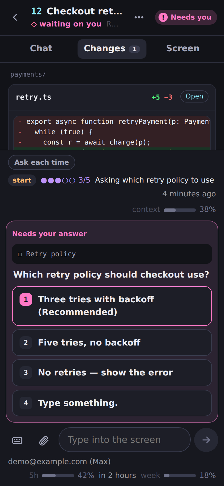
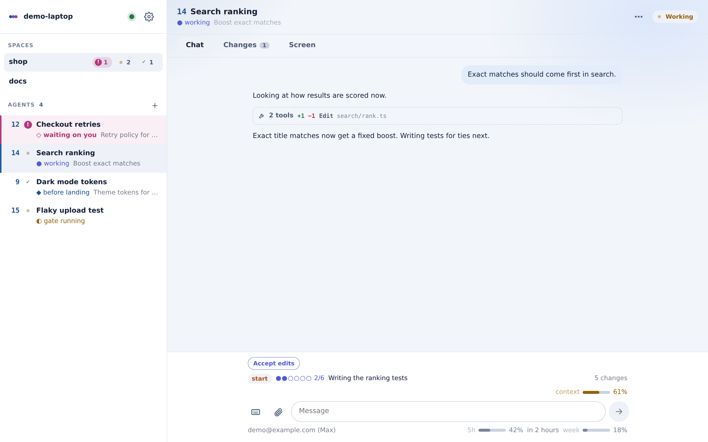
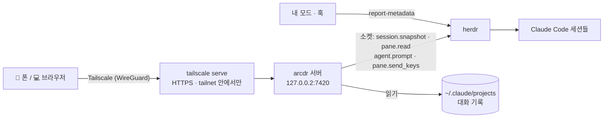

<div align="center">


# arcdr

**주머니 속 herdr.** 내 컴퓨터의 herdr 에서 도는 Claude Code 세션을 모두 보고, 묻는 말에 답하고, 일을 이어 가게
한다 — 폰이나 다른 컴퓨터에서, 내 Tailscale 네트워크로.

[](https://herdr.dev)
[](https://code.claude.com)
[](https://tailscale.com)
[](#폰에-설치하기)
[](https://bun.sh)

[English](README.md) · **한국어**


</div>

---

## 왜 arcdr 인가

herdr 에 Claude Code 세션을 열 개 넘게 띄워 두고 자리를 비운다. 그중 하나가 「재시도 정책은 어느 쪽으로?」 하고
묻고는 한 시간을 기다린다.

- 📱 **한 화면에 전부.** 목록은 herdr 왼쪽 목록과 같은 모양이다 — 번호, 상태, 단계. 나를 기다리는 세션은 분홍으로
  바뀌고 폰이 울린다.
- 👆 **눌러서 답하기.** 권한 확인, 선택 질문, 계획 승인, 폴더 신뢰 확인이 버튼이 된다. 키를 보내기 직전에 화면을
  다시 읽어서, 그새 바뀐 메뉴에 엉뚱한 답이 들어가지 않는다.
- 🔐 **새로 로그인할 것이 없다.** 세션마다 이미 쓰던 Claude 계정 그대로 돈다. arcdr 은 내 Tailscale 신원만 본다.
  계정을 여럿 바꿔 쓰는 수고가 사라진다.
- 🧩 **내 모드가 폰에도.** Claude Code 모드가 herdr 에 보내는 값 — 단계, 진행 점, 쓴 컨텍스트, 사용 한도 — 을 내가
  정한 자리에 정한 모양으로 그린다. [방법 →](docs/mods.ko.md)
- 🪶 **가볍다.** Bun 서버 하나, Preact 화면 하나, 실행 의존성 둘(Preact, `web-push`). herdr 소켓과 Claude Code
  대화 기록을 읽기만 하고, 어느 쪽에도 아무것도 깔지 않는다.

## 할 수 있는 것

<table>
<tr>
<td width="33%"></td>
<td width="33%"></td>
<td width="33%"></td>
</tr>
<tr>
<td><b>모든 세션을 한눈에</b><br/>spaces, 에이전트, 상태, 모드가 보낸 단계.</td>
<td><b>답하고 보내기</b><br/>선택지는 버튼, 한글 입력이 깨지지 않는 입력칸, <code>/</code> · <code>@</code> 자동완성, 붙여넣기로 이미지.</td>
<td><b>무엇이 바뀌었나</b><br/>고친 내용마다 줄 비교, 대화가 건드린 파일 전부, 파일 보기.</td>
</tr>
</table>

<details>
<summary><b>그 밖의 기능</b></summary>

| | |
|---|---|
| **대화** | 채팅 모양: 마크다운 · 표 · 코드, 도구 호출은 한 줄로 접기, 링크는 새 창 |
| **보내기** | 보내는 중 → 입력됨 → 대기 중(에이전트가 일하는 동안) → 받음, 대기 메시지 지금 보내기, 세션별 쓰다 만 글 보관 |
| **키** | Esc, 화살표, Tab, ⇧Tab, Enter — Ctrl+C 는 일부러 뺐다(두 번이면 Claude Code 가 꺼진다) |
| **화면** | 지금 터미널 그대로, 폰 폭에 맞춰 줄바꿈 |
| **세션 안** | 권한 모드 · 모델 칩, 중단, `/compact`, `/context`, `/usage`, 되돌리기, `/clear` |
| **세션 관리** | 어느 폴더에서든 새로 열기(첫 메시지와 함께), 지난 대화 이어 하기, 닫기 |
| **＋ 판** | 키 버튼, 사진·파일, 폰에서는 카메라, 등록한 커맨드 — 입력칸 왼쪽 버튼 하나에 |
| **커맨드** | 자주 쓰는 스킬·커맨드를 서버에 등록해 폰과 PC 가 같은 목록을 씀 — 누르면 입력칸에 넣거나 바로 보냄 |
| **첨부** | ＋ → 사진·파일, 스크린샷 붙여넣기, 끌어다 놓기 — 에이전트가 읽는 곳에 저장해 `@경로` 로 |
| **알림** | 에이전트가 답을 기다리거나 일을 끝내면 웹 푸시 — 모드 값이 내 규칙에 맞을 때도 |
| **모양** | 폰 · PC 배치, 테마: 자동 · Dracula · 밝게 · Arcness · Arcness 밝게 · Nord, 언어: English · 한국어 · 日本語 · 简体中文 |

</details>

<p align="center">

</p>

## 빠른 시작

systemd 가 도는 Linux 나 WSL 에서 [herdr](https://herdr.dev) 로 Claude Code 를 쓰고 있으면 된다.

**Claude Code 로** — 이 저장소를 열고 「arcdr 설치해줘」라고 한다. [`arcdr-setup`](.claude/skills/arcdr-setup/SKILL.md)
스킬이 아래 스크립트를 돌리고, 사람만 열 수 있는 주소 둘을 건네고, 사람이 정할 일은 먼저 묻는다.

**직접:**

```bash
git clone https://github.com/arcnessai/arcdr && cd arcdr
scripts/setup.sh status   # 무엇이 됐고 무엇이 남았는지
scripts/setup.sh all      # 남은 단계를 차례로 — 주소를 열어야 할 때는 종료 코드 10 으로 멈춘다
```

herdr 를 확인하고, Tailscale 을 깔고 로그인하고, tailnet HTTPS 를 켜고, Bun 을 체크섬을 맞춰 깔고, 시험과 빌드를
돌리고, `~/.config/arcdr/env` 를 쓰고, systemd 사용자 서비스로 띄워 `tailscale serve` 로 연다.

### 폰에 설치하기

같은 계정으로 Tailscale 앱을 켜고, Chrome 으로 `https://<기기>.<tailnet>.ts.net` 을 열어 **앱 설치** 를 누른다.
다른 컴퓨터는 Tailscale 을 켜고 같은 주소를 연다.

### 구경만 하기

```bash
bun install && bun run demo   # 가짜 에이전트로 http://127.0.0.1:7430 — herdr 없이
```

## 동작 구조



화면이 열려 있는 동안(그리고 알림을 위해) 서버는 1초마다 herdr 상태를 받아 바뀐 것만 화면에 흘려보낸다. 대화
기록은 지난번에 읽은 곳부터 이어 읽고, 터미널에 메뉴가 떠 있으면 선택지로 바꾼다.

## 보안

들어온 사람은 에이전트 터미널에 글을 칠 수 있고, 그 터미널은 내 사용자 권한으로 돈다. 그래서 입구를 하나만, 좁게 연다.

<details>
<summary><b>하나씩</b></summary>

- **루프백에만.** 서버는 `127.0.0.2` 에 뜬다. WSL 은 `127.0.0.1` 에 뜬 것을 Windows 로 넘기지만 `127.0.0.2` 는
  넘기지 않는다(실측). Windows 쪽 프로그램이 닿지 못한다.
- **내 Tailscale 신원.** 요청마다 `Tailscale-User-Login` 이 있어야 하고(이 기기의 `tailscale serve` 만 붙인다),
  `ARCDR_OWNERS` 에 든 계정이어야 한다. `tailscale funnel` 은 쓰지 않는다.
- **같은 출처의 쓰기만.** 쓰기는 공개한 주소의 `Origin` 이어야 하고, `Host` 도 그 이름이어야 한다.
- **정해 둔 키만.** Ctrl+C 는 없다. 고르기는 화면을 다시 읽어 선택지가 바뀌었으면 거절한다.
- **HTML 로 꽂지 않는다.** 대화 기록에는 어디서 온 글이든 섞인다. 마크다운은 요소로 만든다. CSP 도 엄격하다.
- **파일.** 올리기는 이미지 · PDF · 글 파일만, 내용이 형식과 맞아야 하고, 15MB 까지, 14일 뒤 지운다. 미리보기는
  `~/.ssh` · `~/.claude.json` · 로그인 파일 · `.env` · 키 파일을 링크를 따라간 실제 위치로 판정해 거절한다.
- **푸시.** 구독 주소는 브라우저 푸시 서비스만, 내용은 브라우저용으로 암호화한다.

</details>

## 내 것으로 꾸미기

모드가 herdr 에 값을 보내고, `~/.config/arcdr/display.json` 이 그 값을 어디에 둘지 정한다.

```json
{
  "agent": { "badge": { "from": "token:tree", "color": "cyan", "bold": true },
             "line": [{ "from": "token:stage", "rules": [{ "startsWith": "◇", "color": "pink", "bold": true }] }] },
  "band": [{ "left": [{ "from": "token:progress", "as": "dots" }, { "from": "token:doing" }],
             "right": [{ "from": "token:context", "as": "meter", "rules": [{ "above": 80, "color": "error" }] }] }],
  "alerts": [{ "from": "token:stage", "startsWith": "✓", "body": "{name} 끝남" }]
}
```

칸은 `text` · `chip` · `badge` · `dots` · `meter` · `ago` 로 그리고, 값에 따른 규칙을 붙인다. 파일이 없으면 herdr
자신의 왼쪽 목록 설정을 그대로 옮긴다. 형식 전체와 예시는 **[docs/mods.ko.md](docs/mods.ko.md)** 에 있다.

## 설정

`~/.config/arcdr/env` (설치 스크립트가 쓴다):

| 변수 | 기본값 | |
|---|---|---|
| `ARCDR_OWNERS` | — | 들어올 수 있는 Tailscale 계정, 쉼표로. 반드시 |
| `ARCDR_PUBLIC_HOSTS` | — | `tailscale serve` 가 연 이름, 443 이 아니면 `:포트` 까지 |
| `ARCDR_MACHINE` | 호스트 이름 | 연결 화면에 보일 이름 |
| `ARCDR_HOST` · `ARCDR_PORT` | `127.0.0.2` · `7420` | 루프백만 |
| `ARCDR_TRANSCRIPT_ROOTS` | `~/.claude/projects` | 대화 기록이 있는 곳 |
| `HERDR_SOCKET_PATH` | `~/.config/herdr/herdr.sock` | herdr 소켓 |

## 다른 방법과 견주면

| | SSH 앱 + herdr | Claude 원격 제어 | **arcdr** |
|---|:-:|:-:|:-:|
| 여러 Claude 계정의 세션을 한 목록에 | ✓ | 한 번에 한 계정 | ✓ |
| 폰에서 Claude 로그인 없이 | ✓ | – | ✓ |
| 선택지를 버튼으로 | – | ✓ | ✓ |
| 대화는 채팅으로, 고친 것은 비교로 | – | ✓ | ✓ |
| 모드가 herdr 에 보낸 값 보기 | 터미널 글자로 | ? | ✓ |

## 개발

```bash
bun test              # 접근 판단 · 메뉴 · 대화 기록 · 표시 설정 · 푸시 · 업로드 · 경로
bun run typecheck
bun run check         # prettier + 타입 + 시험
bun run demo          # 가짜 에이전트로 화면 보기
scripts/setup.sh build && scripts/setup.sh service   # 고친 뒤 다시 빌드하고 띄우기
```

`server/` — Bun 서버: `app.ts` 가 `Backend` 위의 경로를, `main.ts` 가 herdr 연결을 맡는다. `web/` — Preact 화면.
입력을 시험할 때는 쓰고 있는 칸이 아니라 따로 띄운 herdr 세션(`herdr --session test server`)을 쓴다.

## 라이선스

아직 정하지 않았다.
