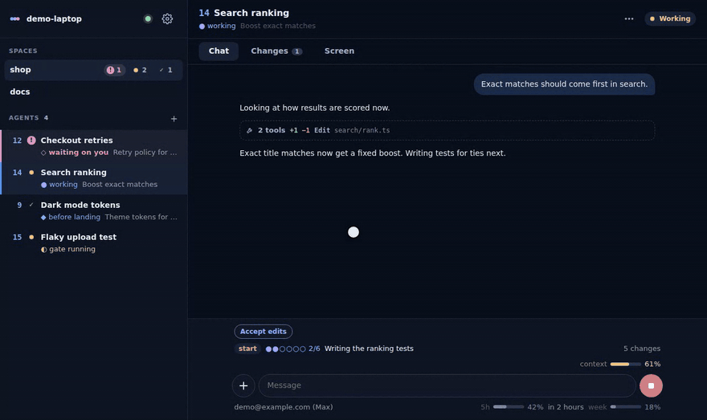
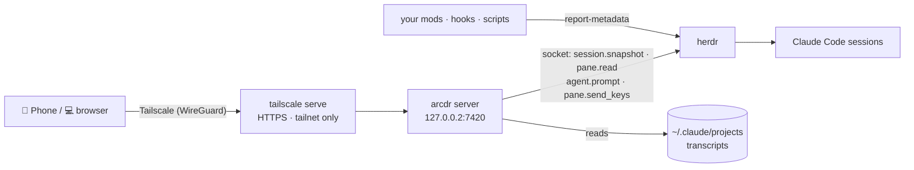

<div align="center">


# arcdr

**Your herdr, on your phone — mods and all.**<br/>
Every Claude Code session herdr runs, shown the way herdr shows it, with whatever your mods report.
Answer its questions and keep it moving from your phone or any other computer, over your own Tailscale network.

[](https://herdr.dev)
[](docs/mods.md)
[](https://tailscale.com)
[](#on-the-phone)
[](https://bun.sh)
[](#safe-by-design)
[](LICENSE)

**[▶ Try it in your browser](https://arcnessai.github.io/arcdr/)** — made-up agents, nothing to install

**English** · [한국어](README.ko.md)



</div>

---

## Start with one sentence

Open Claude Code anywhere on the machine that runs herdr and say:

> **Set up arcdr from https://github.com/arcnessai/arcdr**

Already have a clone? Open it and say *"set it up"*.

The [`arcdr-setup`](.claude/skills/arcdr-setup/SKILL.md) skill clones it, installs what is missing, starts the
service, hands you the two links only you can open (the Tailscale login and its HTTPS switch), and asks before
anything that is yours to decide. At the end it offers the starter mod, so the phone shows more than the chat
from the first minute.

**From herdr:** `herdr plugin install arcnessai/arcdr` adds two panes to herdr — **Set up arcdr** runs the same
setup, waiting for you at each link, and **Open arcdr on your phone** shows the address as a QR code.

<a id="on-the-phone"></a>
**On the phone:** Tailscale app on with the same account → scan the QR code (herdr's pane, or **Settings → Open on
another device** in a browser that already has arcdr) or open `https://<machine>.<tailnet>.ts.net` in Chrome →
**Install app**. Another computer: Tailscale on, open the same address.

<p align="center">

</p>

## Built around herdr and your mods

Most remote views of Claude Code show one conversation. arcdr shows **your workspace** — the one herdr
already arranges and your mods already annotate.

<table>
<tr>
<td width="50%" valign="top">

### herdr-native

- **The list is herdr's sidebar.** arcdr reads your `rows_by_agent` from herdr's own config: the same tree
  numbers, the same stage colours, the same order. Nothing to set up.
- **Spaces and tabs as herdr has them.** Start a session in a new herdr tab, resume an old conversation,
  close one — from the phone.
- **Status from herdr's agent detection.** The one waiting on you turns pink and your phone buzzes.
- **Several at once on a desktop.** Up to four conversations side by side or in a 2×2 grid, like herdr's own
  split panes.
- **Sessions on any Claude account.** Each pane keeps the account it runs as; arcdr only asks who you are on
  Tailscale.

</td>
<td width="50%" valign="top">

### Your mods, on the phone

| In the terminal, a mod draws… | arcdr shows it… |
|---|---|
| a token in herdr's sidebar row | before or under the agent's name |
| the band above the prompt | above the message box |
| the prompt footer | below the message box |
| a notice | as a phone notification |
| a registered command | in the `/` suggestions |

Same values, same places, the way you arranged them.

</td>
</tr>
</table>

### Why another herdr client?

There are good phone clients for herdr already. arcdr is the one to pick if:

- **you use Claude Code mods**, or want herdr's own sidebar rows on the phone — arcdr draws what your mods
  report where you place it, and lets a mod ring your phone;
- **you run several Claude accounts** side by side — each pane keeps its own;
- **you want the narrowest way in** — loopback only, your Tailscale identity checked on every request, no tokens to
  pair, store or leak, no relay;
- **you also sit at a desktop** — four conversations at once, the same app.

### Four ways to put something on the phone

| | |
|---|---|
| 🧩 **The starter mod** | `scripts/setup.sh mod` installs [`arcdr-report`](mods/arcdr-report/README.md). From then on each session shows the tool at work (`Edit rank.ts`), how long it has been at it, its to-do list as `●●●○○ 3/5`, the context used, branch, cost and usage limits. No code. |
| 💬 **Just ask** | In this repository, tell Claude Code *"show my git branch on the phone"* or *"ping my phone when the tests fail"*. The [`arcdr-mod`](.claude/skills/arcdr-mod/SKILL.md) skill finds or writes the hook or mod that reports it, places it, and checks it shows. |
| 🎨 **Tap it in** | **Settings → Display → Customize** lists every value your mods send. Pick where it goes and how it looks (chip, dots, bar, "4 min ago"), with a live preview. |
| 🔔 **Ring the phone** | Any mod, hook or script: `herdr pane report-metadata "$HERDR_PANE_ID" --token notify="Deploy finished"` — and it arrives as a notification. |

<table>
<tr>
<td width="50%"></td>
<td width="50%"></td>
</tr>
<tr>
<td><b>Customize from the phone</b><br/>Every value your mods report, its place and its look, previewed as you tap.</td>
<td><b>The band, off the terminal</b><br/>What your mods draw above Claude Code's prompt, above the message box.</td>
</tr>
</table>

The full format, every place, and a worked example: **[docs/mods.md](docs/mods.md)**.

## Safe by design

A remote client for coding agents is a remote shell: whoever gets in can type into terminals that run as you.
arcdr is built around that one fact. Before you put any such tool on your phone, check it against this list.

| What goes wrong in tools like this | What arcdr does |
|---|---|
| **Reachable from more places than you think** — the LAN, the Windows side of WSL, the internet | Listens on `127.0.0.2` only, which WSL does not forward to Windows (measured), and is published only inside your tailnet with `tailscale serve`. Never `tailscale funnel` |
| **A token or pairing code that can leak** — in a URL, in browser storage, in a screenshot | No tokens at all. Every request must carry your Tailscale identity, which only `tailscale serve` on this machine sets, and it must be a login you listed |
| **A relay or a cloud in the middle** | None. Your phone talks to your machine over WireGuard. The only outside service is Web Push, if you turn it on, and its payloads are encrypted for your browser |
| **Code that updates itself from the internet and runs as you** | No self-update. You update with `git pull`, after reading what changed |
| **Telemetry and update checks** | None. The page may talk only to its own server (`connect-src 'self'`); the server reaches out only for the Web Push you turned on |
| **Any key at any time** — Ctrl+C twice ends a session | Keys come from an allow list without Ctrl+C. Choosing an option reads the screen again and refuses if the menu changed |
| **Transcript text drawn as HTML** — a README the agent reads could run script on your phone | Markdown is built as elements, never as HTML. A strict Content-Security-Policy on top |
| **Another web page making your browser send commands** | Writes need your published address as `Origin` and `Host` |
| **Reading any file on the machine** | Uploads are checked against their type, capped, and kept in one folder. The file viewer refuses `~/.ssh`, `.env`, login files and keys, judged after following links |

Small enough to read in an afternoon: one Bun server and one Preact page, three small runtime dependencies.
Found a problem? Report it privately — [SECURITY.md](SECURITY.md).

## What else you can do

<table>
<tr>
<td width="33%"></td>
<td width="33%"></td>
<td width="33%"></td>
</tr>
<tr>
<td><b>Every session at a glance</b><br/>Spaces, agents, status, the stage your mod reports.</td>
<td><b>Answer with a tap</b><br/>Permission prompts, questions, plan approvals, folder trust — as buttons. The screen is read again right before the keys go out.</td>
<td><b>＋ for everything else</b><br/>Key buttons, photos from the gallery, the camera, files, and the skills and commands you use most.</td>
</tr>
</table>

<details>
<summary><b>The whole list</b></summary>

| | |
|---|---|
| **Chat** | The conversation as chat: Markdown, tables, code; tool calls folded into one line; links open in a new tab |
| **Sending** | Sending → typed in → queued (while the agent works) → received; *send queued now*; a draft kept per session; Korean IME–safe |
| **Completion** | `/` for built-in commands, skills and your mods' commands; `@` for files |
| **Commands** | Skills and commands you use often, kept on the server so the phone and the laptop show the same; a tap puts one in the box or sends it |
| **Attachments** | ＋ → Photos (straight to the gallery), Camera (on a phone) or Files; paste a screenshot, or drop a file; saved where the agent reads it, sent as `@path` |
| **Changes** | Each edit as a diff, every file the conversation touched, a file viewer |
| **Keys** | Esc, arrows, Tab, ⇧Tab, Enter; Ctrl+C is left out on purpose (twice exits Claude Code) |
| **Screen** | The terminal as it is now, wrapped for a phone |
| **Session** | A stop button where send is while the agent works (Esc ends its turn); permission-mode and model chips, `/compact`, `/context`, `/usage`, rewind, `/clear` |
| **Sessions** | Start one in any folder (optionally with a first message), resume an earlier conversation, close one |
| **Notifications** | Web Push when an agent needs you or finishes, when a mod sends `notify`, or when a value matches your rule |
| **Panes** | On a desktop, up to four conversations at once: ⊞ on an agent (or Ctrl+click) opens it beside the others — two side by side, three, or a 2×2 grid; kept per device |
| **Looks** | Phone and desktop layouts; themes: Auto, Dracula, Light, Arcness, Arcness Light, Nord; text size in five steps and the device's own typefaces (default, serif, monospace), per device; English, 한국어, 日本語, 简体中文 |

</details>

### On a desktop: up to four at once

<p align="center">

</p>

Hover an agent in the list and press ⊞ — or Ctrl+click it (⌘+click on a Mac) — to open it beside the ones
already open: two side by side, three with the first down the left, four in a 2×2 grid. A plain click puts
the agent in the pane you are in, × closes a pane, and the layout is kept per device. A half-height pane
waiting for an answer clears its frame so the question and the conversation both fit. On a phone, one at a
time as before.

## Set up by hand

You need [herdr](https://herdr.dev) running Claude Code on a Linux or WSL machine with systemd.

```bash
git clone https://github.com/arcnessai/arcdr && cd arcdr
scripts/setup.sh status   # what is done, what is left
scripts/setup.sh all      # every step; stops with exit code 10 when you have to open a link
scripts/setup.sh mod      # optional: the starter mod
```

It checks herdr, installs and logs in Tailscale, turns on tailnet HTTPS, installs Bun (checksum verified), runs
the tests and builds, writes `~/.config/arcdr/env`, starts a systemd user service that comes back by itself
after a restart (on WSL it turns on linger for that), and publishes it with `tailscale serve`.

**Just look around:** `bun install && bun run demo` — made-up agents on http://127.0.0.1:7430, no herdr needed.

## How it works



The server asks herdr for a snapshot once a second while a page is open (and for notifications), streams
changes to the page, reads each session's transcript from where its last read ended, and turns the visible
terminal into choices when a menu is on it. `display.json` decides where each reported value is drawn. arcdr
installs nothing into herdr or Claude Code; the starter mod is yours to add or leave out.

## Configuration

`~/.config/arcdr/env` (the setup writes it):

| Variable | Default | |
|---|---|---|
| `ARCDR_OWNERS` | — | Tailscale logins allowed in, comma-separated. Required |
| `ARCDR_PUBLIC_HOSTS` | — | The name `tailscale serve` publishes, with `:port` when not 443 |
| `ARCDR_MACHINE` | hostname | Shown on the connect screen |
| `ARCDR_HOST` · `ARCDR_PORT` | `127.0.0.2` · `7420` | Loopback only |
| `ARCDR_TRANSCRIPT_ROOTS` | `~/.claude/projects` | Where transcripts are |
| `HERDR_SOCKET_PATH` | `~/.config/herdr/herdr.sock` | herdr's socket |

Beside it: `display.json` (what shows where — [docs/mods.md](docs/mods.md)) and `shortcuts.json` (your commands).

## Compared with

| | SSH app + herdr | Claude Remote Control | **arcdr** |
|---|:-:|:-:|:-:|
| Sessions of several Claude accounts in one list | ✓ | one account at a time | ✓ |
| The list as herdr's sidebar shows it | as terminal text | – | ✓ |
| What your mods report, placed where you want | as terminal text | – | ✓ |
| No Claude login on the phone | ✓ | – | ✓ |
| Choices as buttons | – | ✓ | ✓ |
| Conversation as chat, edits as diffs | – | ✓ | ✓ |

## Development

```bash
bun run test             # access gate, menus, transcripts, display spec and editor, push, uploads, routes
bun run typecheck
bun run check            # prettier + types + tests
bun run demo             # the screens with made-up agents
bun run display tokens   # what your panes report right now
scripts/setup.sh build && scripts/setup.sh service   # rebuild and restart your install
```

`server/` — Bun server: `app.ts` routes over a `Backend`, `main.ts` wires herdr. `web/` — the Preact page.
`mods/arcdr-report/` — the starter mod (`claude plugin test .` inside it). To test input, use a separate herdr
session (`herdr --session test server`), never the panes you work in.

Contributions are welcome — see [CONTRIBUTING.md](CONTRIBUTING.md). Found a security problem? Please report it
privately ([SECURITY.md](SECURITY.md)). Changes per release: [CHANGELOG.md](CHANGELOG.md).

## License

[MIT](LICENSE) © 2026 Arcness
