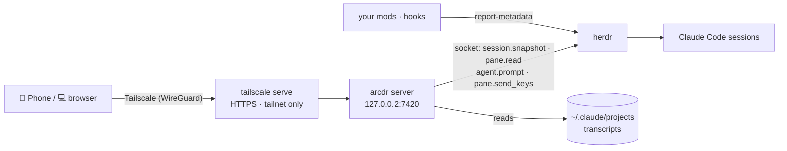

<div align="center">


# arcdr

**herdr in your pocket.** Watch every Claude Code session herdr runs on your computer, answer its questions,
and keep it moving — from your phone or any other computer, over your own Tailscale network.

[](https://herdr.dev)
[](https://code.claude.com)
[](https://tailscale.com)
[](#install-it-on-the-phone)
[](https://bun.sh)

**English** · [한국어](README.ko.md)


</div>

---

## Why arcdr

You run a dozen Claude Code sessions in herdr. You step away. One of them stops to ask *"which retry policy?"*
and waits — for an hour.

- 📱 **One page for all of them.** The list looks like herdr's sidebar: number, status, stage. The one waiting
  for you turns pink, and your phone buzzes.
- 👆 **Answer with a tap.** Permission prompts, questions, plan approvals and folder-trust dialogs become
  buttons. The screen is read again right before the keys go out, so a changed menu never gets the wrong answer.
- 🔐 **Nothing new to log into.** Each session keeps the Claude account it already runs as; arcdr only needs your
  Tailscale identity. Accounts you switch between stop being a chore.
- 🧩 **Your mods, on the phone.** Whatever your Claude Code mods report to herdr — a stage, progress dots, the
  context used, usage limits — arcdr draws where you say, the way you say. [How →](docs/mods.md)
- 🪶 **Small.** One Bun server and one Preact page; two runtime dependencies (Preact, `web-push`). Reads herdr's
  socket and Claude Code's transcripts, and installs nothing into either.

## What you can do

<table>
<tr>
<td width="33%"></td>
<td width="33%"></td>
<td width="33%"></td>
</tr>
<tr>
<td><b>Every session at a glance</b><br/>Spaces, agents, status, the stage your mod reports.</td>
<td><b>Answer and send</b><br/>Choices as buttons, Korean IME–safe input, <code>/</code> and <code>@</code> completion, images by paste.</td>
<td><b>See what changed</b><br/>Each edit as a diff, every file the conversation touched, a file viewer.</td>
</tr>
</table>

<details>
<summary><b>Everything else</b></summary>

| | |
|---|---|
| **Chat** | The conversation as chat: Markdown, tables, code; tool calls folded into one line; links open in a new tab |
| **Sending** | Sending → typed in → queued (while the agent works) → received; *send queued now*; draft kept per session |
| **Keys** | Esc, arrows, Tab, ⇧Tab, Enter; Ctrl+C is left out on purpose (twice exits Claude Code) |
| **Screen** | The terminal as it is now, wrapped for a phone |
| **Session** | Permission-mode and model chips, interrupt, `/compact`, `/context`, `/usage`, rewind, `/clear` |
| **Sessions** | Start one in any folder (optionally with a first message), resume an earlier conversation, close one |
| **＋ tray** | Key buttons, a photo or file, the camera on a phone, and your kept commands — one button left of the message box |
| **Commands** | Skills and commands you use often, kept on the server so the phone and the laptop show the same; a tap puts one in the box or sends it |
| **Attachments** | ＋ → photo or file, paste a screenshot, or drop a file; saved where the agent reads it, sent as `@path` |
| **Notifications** | Web Push when an agent needs you or finishes — or when a mod's value matches your rule |
| **Looks** | Phone and desktop layouts; themes: Auto, Dracula, Light, Arcness, Arcness Light, Nord; English, 한국어, 日本語, 简体中文 |

</details>

<p align="center">

</p>

## Quick start

You need [herdr](https://herdr.dev) running Claude Code on a Linux or WSL machine with systemd.

**With Claude Code** — open this repository and say *"set up arcdr"*. The
[`arcdr-setup`](.claude/skills/arcdr-setup/SKILL.md) skill runs the script below, hands you the two links only
you can open, and asks before anything that is yours to decide.

**By hand:**

```bash
git clone https://github.com/arcnessai/arcdr && cd arcdr
scripts/setup.sh status   # what is done, what is left
scripts/setup.sh all      # every step; stops with exit code 10 when you have to open a link
```

It checks herdr, installs and logs in Tailscale, turns on tailnet HTTPS, installs Bun (checksum verified), runs
the tests and builds, writes `~/.config/arcdr/env`, starts a systemd user service, and publishes it with
`tailscale serve`.

### Install it on the phone

Turn on the Tailscale app with the same account, open `https://<machine>.<tailnet>.ts.net` in Chrome, and
choose **Install app**. On another computer: Tailscale on, open the same address.

### Just look around

```bash
bun install && bun run demo   # made-up agents on http://127.0.0.1:7430 — no herdr needed
```

## How it works



The server asks herdr for a snapshot once a second while a page is open (and for notifications), streams
changes to the page, reads each session's transcript from where its last read ended, and turns the visible
terminal into choices when a menu is on it.

## Security

Whoever gets in can type into your agents' terminals, which run as your user. So there is one way in, kept narrow.

<details>
<summary><b>The model, step by step</b></summary>

- **Loopback only.** The server binds `127.0.0.2`. WSL forwards `127.0.0.1` listeners to Windows; it does not
  forward `127.0.0.2` (measured), so Windows programs cannot reach it.
- **Your Tailscale identity.** Every request must carry `Tailscale-User-Login`, which only `tailscale serve` on
  this machine sets, and name a login in `ARCDR_OWNERS`. Never `tailscale funnel`.
- **Same-origin writes.** Writes need an `Origin` of the published host; `Host` must be that name.
- **Keys from a list.** No Ctrl+C. Choosing re-reads the screen and refuses if the option changed.
- **Nothing rendered as HTML.** Transcripts carry text from anywhere; Markdown is built as elements. Strict CSP.
- **Files.** Uploads: images, PDF, text; content checked against the type; 15 MB; swept after 14 days.
  Preview: refuses `~/.ssh`, `~/.claude.json`, login files, `.env`, key files, judged after following links.
- **Push.** Subscriptions only to browser push services; payloads encrypted for the browser.

</details>

## Make it yours

Your mods report values to herdr; `~/.config/arcdr/display.json` decides where they go:

```json
{
  "agent": { "badge": { "from": "token:tree", "color": "cyan", "bold": true },
             "line": [{ "from": "token:stage", "rules": [{ "startsWith": "◇", "color": "pink", "bold": true }] }] },
  "band": [{ "left": [{ "from": "token:progress", "as": "dots" }, { "from": "token:doing" }],
             "right": [{ "from": "token:context", "as": "meter", "rules": [{ "above": 80, "color": "error" }] }] }],
  "alerts": [{ "from": "token:stage", "startsWith": "✓", "body": "{name} finished" }]
}
```

Parts are drawn as `text`, `chip`, `badge`, `dots`, `meter` or `ago`, with rules on the value. Without a file,
arcdr copies herdr's own sidebar rows. **[docs/mods.md](docs/mods.md)** has the whole format and a worked example.

## Configuration

`~/.config/arcdr/env` (the setup writes it):

| Variable | Default | |
|---|---|---|
| `ARCDR_OWNERS` | — | Tailscale logins allowed in, comma-separated. Required |
| `ARCDR_PUBLIC_HOSTS` | — | The name `tailscale serve` publishes, with `:port` when not 443 |
| `ARCDR_MACHINE` | hostname | Shown on the connect screen |
| `ARCDR_HOST` · `ARCDR_PORT` | `127.0.0.2` · `7420` | Loopback only |
| `ARCDR_TRANSCRIPT_ROOTS` | `~/.claude/projects` | Where transcripts are |
| `HERDR_SOCKET_PATH` | `~/.config/herdr/herdr.sock` | herdr's socket |

## Compared with

| | SSH app + herdr | Claude Remote Control | **arcdr** |
|---|:-:|:-:|:-:|
| Sessions of several Claude accounts in one list | ✓ | one account at a time | ✓ |
| No Claude login on the phone | ✓ | – | ✓ |
| Choices as buttons | – | ✓ | ✓ |
| Conversation as chat, edits as diffs | – | ✓ | ✓ |
| Shows what your mods report to herdr | as terminal text | ? | ✓ |

## Development

```bash
bun test              # access gate, menus, transcripts, display spec, push, uploads, routes
bun run typecheck
bun run check         # prettier + types + tests
bun run demo          # the screens with made-up agents
scripts/setup.sh build && scripts/setup.sh service   # rebuild and restart your install
```

`server/` — Bun server: `app.ts` routes over a `Backend`, `main.ts` wires herdr. `web/` — the Preact page.
To test input, use a separate herdr session (`herdr --session test server`), never the panes you work in.

## License

Not chosen yet.
